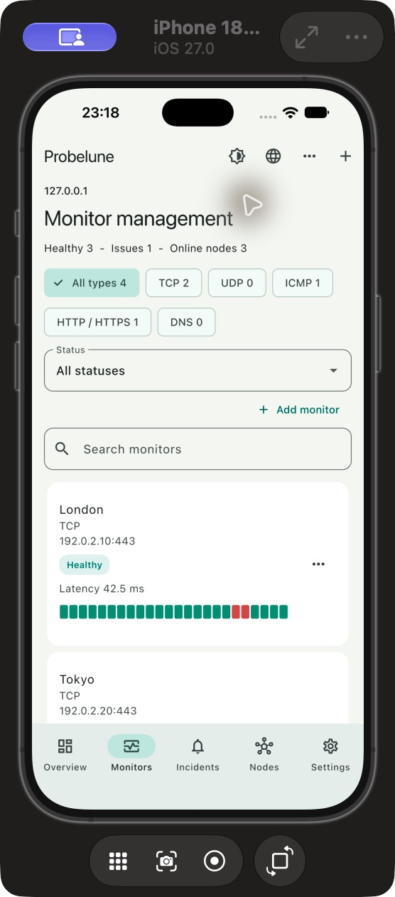

# Probelune Mobile

[简体中文](README.zh-CN.md) | [Dashboard](https://github.com/sihuangtech/probelune-dashboard) | [Product / PRD](https://github.com/sihuangtech/probelune)

The Flutter Android/iOS companion for **Probelune**. Connect to your dashboards, compare observations, investigate incidents and start remote rechecks from your phone. The app does not run a background probe.

Availability history supports 15-minute, hourly and custom cell durations. Missing samples remain unknown; coverage is displayed separately from availability. Diagnostic runs remain grouped across nodes.

## Probelune repositories

Probelune consists of six repositories. This repository is **probelune-mobile**. Use the links below to find the other components.

For a self-hosted installation, start with the dashboard and probe node. Mobile and desktop clients connect to that dashboard. Contracts provide shared definitions for development.

| Repository | Purpose |
| --- | --- |
| [probelune](https://github.com/sihuangtech/probelune) | Product overview, architecture and deployment guides |
| [probelune-dashboard](https://github.com/sihuangtech/probelune-dashboard) | Web dashboard and Go API server |
| [probelune-node](https://github.com/sihuangtech/probelune-node) | Probe executor for monitored networks |
| [probelune-mobile](https://github.com/sihuangtech/probelune-mobile) | Flutter client for Android and iOS |
| [probelune-desktop](https://github.com/sihuangtech/probelune-desktop) | Electron desktop client and diagnostic tools |
| [probelune-contracts](https://github.com/sihuangtech/probelune-contracts) | Shared Go models, validation and API protocols |


## Preview



Example data only. The application supports language and light/dark/system theme switching.

## Features

1. Multiple self-hosted instances; password login or short-lived, single-use pairing QR codes.
2. Server overview and monitor management with protocol/status filters, recent uptime cells and latency.
3. Create, edit, copy, pause and archive monitors with protocol-specific configuration and permissions.
4. Historical evidence with source/status/stage filters, paging, time-cell selection and native JSON sharing.
5. Node registration and credential management; notification channels, delivery history and maintenance windows.
6. Instance settings, members, audit history, sessions, devices and pairing QR codes, subject to server roles.
7. Incident timelines, acknowledgement, notes and one-hour silence, subject to server roles.
8. Immediate rechecks with per-node results, progress and cancellation inside the app.
9. Secure sessions and last-known overview cache (up to 24 hours), clearly marked offline.
10. English, Simplified and Traditional Chinese, Japanese, Korean, German, French and Spanish, with system-language detection and a language picker.
11. Optional native push using the deployer's Firebase/APNs setup.

## Run and build

Use stable Flutter (validated with Flutter 3.47.8 / Dart 3.13.7), Android SDK/JDK or Xcode for the target platform.

```sh
git clone https://github.com/sihuangtech/probelune-mobile.git
cd probelune-mobile
flutter pub get
flutter analyze
flutter run
flutter build apk --debug
flutter build ios --no-codesign
```

Connect to the HTTPS origin of a running dashboard. An explicit checkbox permits HTTP for controlled local networks. Android emulators reach the host via `10.0.2.2`; physical phones need a LAN/VPN hostname. The phone's localhost is not your server.

Pairing: in dashboard Settings choose Pair mobile device, then scan within two minutes. Codes contain no passwords or permanent tokens. Mobile sessions last 30 days and are revocable. Removing an instance attempts remote device/session revocation and clears local data.

The build commands produce an Android debug APK and an unsigned iOS app. Neither proves production signing or store readiness. See [release and push setup](docs/RELEASE.md). Release builds never silently use a debug signing key.

## Development

`lib/screens` contains pages; `widgets` contains reusable presentation; `services` owns HTTP, secure storage and push. `models.dart` and `localization.dart` are shared helpers. No embedded backend or adjacent repository is needed. Use official `flutter pub add/remove/upgrade` commands for dependencies and commit `pubspec.lock`.

[Privacy](docs/PRIVACY.md) | [Releases](https://github.com/sihuangtech/probelune-mobile/releases) | [Contributing](CONTRIBUTING.md) | [Security](SECURITY.md) | [Acceptance](https://github.com/sihuangtech/probelune/blob/main/docs/acceptance.md)

[GPL-3.0-or-later](LICENSE). Actual native push, signed installations and store publication require deployer credentials and real-device validation.

## Star History

[](https://star-history.com/#sihuangtech/probelune-mobile&Date)

## Contact

1. Developer: [Snake Konginchrist](https://github.com/Snake-Konginchrist)
2. Email: [developer@skstudio.cn](mailto:developer@skstudio.cn)
3. Feedback: [GitHub Issues](https://github.com/sihuangtech/probelune-mobile/issues)

[Localization](docs/LOCALIZATION.md)
