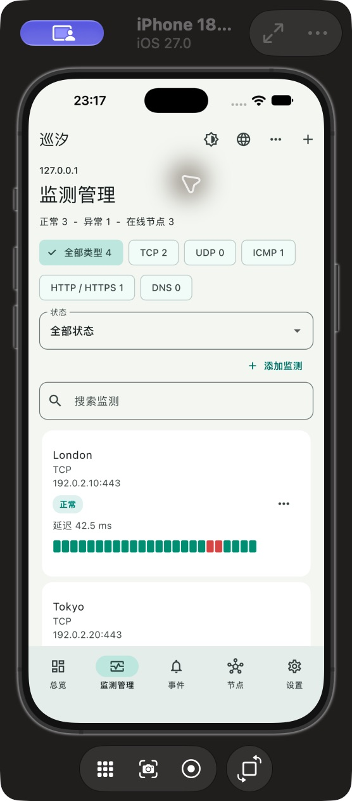

# 巡汐移动端

[English](README.md) | [网页面板](https://github.com/sihuangtech/probelune-dashboard) | [产品与 PRD](https://github.com/sihuangtech/probelune)

Flutter Android/iOS 客户端，连接自托管面板，在手机查看多位置监测、处理故障并发起远程复查。手机不充当持续后台探针。

可用性历史支持 15 分钟、每小时及自定义色块粒度，缺测保持未知，可用率与覆盖率分开显示；同一次诊断按节点分组查看。

## 了解 Probelune

移动客户端连接你自己的面板，方便随时查看服务状态、处理告警和排查问题。

开始自部署时，先配置网页面板和探测节点，再按需要连接手机或桌面客户端。完整架构与部署指南可以在项目总览中找到。

| 组件 | 用途 |
| --- | --- |
| [项目总览](https://github.com/sihuangtech/probelune) | 项目总览、架构与部署指南 |
| [网页面板](https://github.com/sihuangtech/probelune-dashboard) | 网页控制台与 Go API 服务端 |
| [探测节点](https://github.com/sihuangtech/probelune-node) | 部署在监测网络中的探测执行器 |
| [移动客户端](https://github.com/sihuangtech/probelune-mobile) | Flutter Android 与 iOS 移动客户端 |
| [桌面客户端](https://github.com/sihuangtech/probelune-desktop) | Electron 桌面客户端与诊断工具 |
| [协议与数据定义](https://github.com/sihuangtech/probelune-contracts) | 共享 Go 数据结构、参数校验与接口协议 |


## 界面预览



截图使用演示数据。应用支持语言切换，以及浅色、深色和跟随系统三种主题。

## 功能

1. 多实例保存与切换，密码登录、一次性短期二维码配对。
2. 按服务器汇总的总览，监测管理支持协议和状态筛选、列表历史色块与延迟。
3. 按权限新增、编辑、复制、暂停和归档监测，按协议配置检测参数。
4. 历史结果支持来源、状态、执行阶段筛选，翻页、色块时段选择及系统分享 JSON。
5. 节点注册与凭据轮换、通知渠道与投递记录、维护窗口。
6. 面板设置、成员管理、审计日志、会话设备管理与配对二维码，由服务器校验权限。
7. 事件时间线、确认、备注、一小时静默，由服务器校验权限。
8. 手机内查看即时复查进度、各节点结果并取消未完成任务。
9. 安全存储会话与最长 24 小时的总览缓存，离线时显示旧数据时间。
10. 支持简体中文、繁体中文、英语、日语、韩语、德语、法语和西班牙语，可跟随系统或手动切换；可选接入自己的 Firebase/APNs 原生推送。

## 开发与构建

已验证 Flutter 3.47.8 / Dart 3.13.7。Android 需要 Android SDK/JDK，iOS 需要 macOS/Xcode。

```sh
git clone https://github.com/sihuangtech/probelune-mobile.git
cd probelune-mobile
flutter pub get
flutter analyze
flutter run
flutter build apk --debug
flutter build ios --no-codesign
```

输入面板 HTTPS 根地址；受控开发环境可显式允许 HTTP。Android 模拟器通过 `10.0.2.2` 访问电脑，真机使用局域网/VPN 地址。手机 localhost 不指向电脑。

面板“设置 → 配对移动端”的二维码两分钟有效且仅用一次，不包含密码或长期令牌。移动会话有效期 30 天，可在面板撤销。删除实例会尝试撤销远程会话和设备注册，并清除本地数据。

上述构建命令生成 Android 调试包和 iOS 无签名产物。[发布与推送说明](docs/RELEASE.md)包含正式签名、Firebase/APNs 与真机验收。发布构建不会自动回退到 debug 密钥；构建成功不代表推送送达或上架成功。

`lib/screens` 为页面，`widgets` 为复用界面，`services` 负责网络、安全存储和推送。不内置后端、不依赖同级仓库源码。依赖使用 `flutter pub add/remove/upgrade` 官方命令管理并提交锁文件。

[隐私](docs/PRIVACY.md) | [发布记录](https://github.com/sihuangtech/probelune-mobile/releases) | [贡献](CONTRIBUTING.md) | [安全](SECURITY.md) | [验收](https://github.com/sihuangtech/probelune/blob/main/docs/acceptance.md)

采用 [GPL-3.0-or-later](LICENSE) 开源。

## 星标历史

[](https://star-history.com/#sihuangtech/probelune-mobile&Date)

## 联系开发者

1. 开发者: [Snake Konginchrist](https://github.com/Snake-Konginchrist)
2. 邮箱: [developer@skstudio.cn](mailto:developer@skstudio.cn)
3. 问题反馈: [GitHub Issues](https://github.com/sihuangtech/probelune-mobile/issues)

[本地化说明](docs/LOCALIZATION.md)
